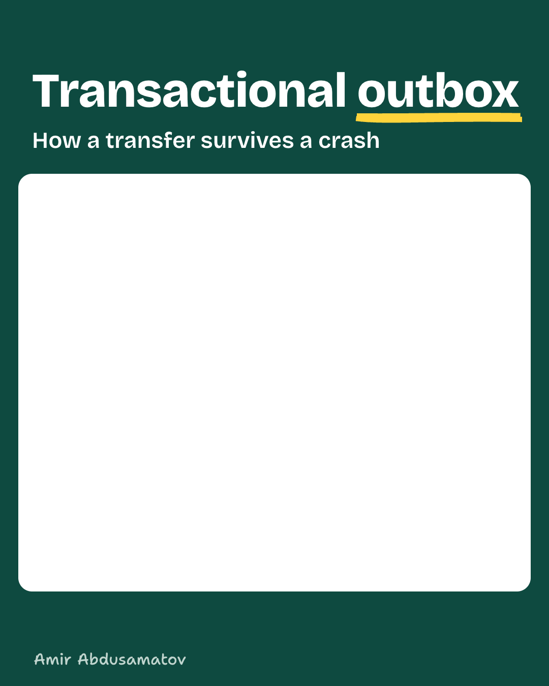
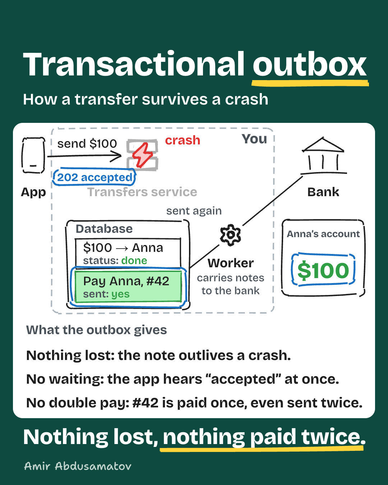
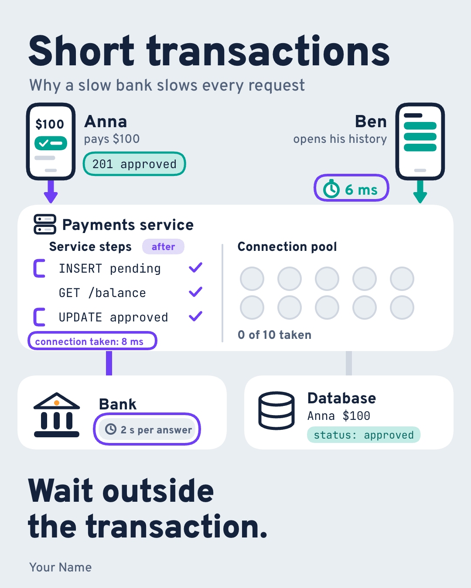

# linkedin-lesson

An [Agent Skill](https://agentskills.io) that turns one technical idea from AI or backend into a
LinkedIn lesson: a short English post and an animated GIF that a mixed feed can follow, engineers
and non-engineers alike. It works with any agent that loads `SKILL.md` skills: Claude Code, Codex,
Cursor, Gemini CLI, OpenCode and others.



The example above and its post text are in
[`skills/linkedin-lesson/examples/outbox/`](skills/linkedin-lesson/examples/outbox/). The GIF comes
in two looks, and the skill asks which one for each lesson (see [Looks](#looks)).

## Install

With the [skills CLI](https://github.com/vercel-labs/skills), for any agent:

```bash
npx skills add kickcs/linkedin-lesson
npx skills add heygen-com/hyperframes
npx skills add petergyang/no-ai-slop
```

The first command offers the four skills in this repo; take all of them. From HyperFrames take
`hyperframes` and `hyperframes-cli`. Add `-g` to install for your user instead of the current
project and `-a <agent>` to pick the agent (`-a '*'` for every agent you have).

As a Claude Code plugin, with updates:

```
/plugin marketplace add kickcs/linkedin-lesson
/plugin install linkedin-lesson@linkedin-lesson
```

Add `hyperframes` and `no-ai-slop` with the skills CLI as above. The recipe always runs the
HyperFrames CLI it was tested with, `npx hyperframes@0.9.19`, whichever way the `hyperframes`
skill is installed.

As a Gemini CLI extension:

```bash
gemini extensions install https://github.com/kickcs/linkedin-lesson
```

Or copy the folders in `skills/` into your agent's skills directory by hand.

## Requirements

- macOS or Linux; on Windows, run the agent inside WSL. The build steps use a POSIX shell and `perl`.
- Node.js 22 or newer (HyperFrames needs it).
- Google Chrome or Chromium. If it is not in a standard place, set `CHROME=/path/to/chrome`.
- ffmpeg.
- Network on the first build: the skill runs `npx hyperframes@0.9.19` and downloads GSAP from npm
  (cached in `~/.cache/linkedin-lesson`).
- For lessons about AI: access to a model (an API key or a local one). Numbers and model answers in
  the frame come from a small prototype the agent runs, not from memory.

## Use

Ask your agent for a lesson, for example: “Make a LinkedIn lesson about the transactional outbox
pattern.” The skill stops for you four times: to pick a topic (if you did not bring one), to
confirm the story in plain words, to pick the look of the GIF, and to approve the lesson card and
the hook. The rest it does on its own.

It keeps your brand in `~/.media/brands/<brand>/`: profile, voice, a log of posts and an idea bank.
The first run asks for the brand name and only what it cannot find out itself.

## Looks

The skill shows the looks with a sample frame and asks which one to use for each lesson; Board is
the default.

| Board | Cards |
| --- | --- |
|  |  |
| A green chalkboard with a white sheet: a hand-drawn scene, results that accumulate on the board. Takes a brand theme. | Each part of the system is a white rounded card with its state; requests and replies are chips on the links. |

The looks are listed in
[`recipe/looks.md`](skills/linkedin-lesson/recipe/looks.md); each lives in its own folder under
`recipe/looks/`.

### Theme for Board

To use your own colors, fonts or a cleaner stroke in Board, ask the agent at any lesson (“use my
brand colors”) or write `~/.media/brands/<brand>/theme.json` yourself:

```json
{
  "colors": { "field": "#1b1f3b", "dim": "#3d4470", "chalk": "#7ee0ff", "soft": "#c9cde8" },
  "fonts": { "sans": { "family": "Inter", "file": "fonts/InterVariable.woff2", "weight": "100 900" } },
  "rough": 0.4
}
```

Every key is optional. Colors use the palette names, fonts the roles `sans`, `hand` and `mono` with
a file next to `theme.json`, and `rough` scales the hand-drawn wobble from 0 (clean) to 2. The theme
is checked before each build: a wrong key stops it with the reason, low text contrast prints a
warning. The frame layout stays the same under any theme. All keys and limits are in
[`recipe/looks/board/theme.md`](skills/linkedin-lesson/recipe/looks/board/theme.md).

### Beyond the theme

A different layout, zones, frame size or a new look needs a fork: edits to an installed copy are
lost on the next install or update. In `skills/linkedin-lesson/recipe/looks/<look>/`, the zones and
their sizes live in the look's engine in `kit/`, the starting scenes in `layouts/`, and the
description the agent builds from in `look.md`; keep the three in agreement. The minimum font sizes
of the preview are in `look.json`, the allowed frame sizes in `bin/gifcheck.mjs` (`SIZES`). A new
look is a new folder next to the others and a line in `recipe/looks.md`. Run `npm test` and
`npm run smoke` after each change; `AGENTS.md` tells an agent working on the fork the same.

## How it works

1. **Foundation**: load or create the brand profile (`brand-profile`, `voice-builder`).
2. **Topic**: take your idea or offer a few.
3. **Story**: tell the lesson in plain words before any frame, with the steps before and after the
   fix; you confirm you understood why the technique matters and pick the fix you would build.
4. **Look**: pick how the GIF is drawn, from sample frames.
5. **Lesson card**: events of the GIF, texts, and every number with its source. Numbers from
   experience come from a small prototype run, repeatable with a seed.
6. **Post text**: three paragraphs, an observation from practice, the problem, the solution
   (`hook-writer`, `no-ai-slop`, `postcheck`).
7. **Approval**: the card, the hook options, the text and a key frame.
8. **Build**: HyperFrames renders the GIF from the recipe in
   [`skills/linkedin-lesson/recipe/`](skills/linkedin-lesson/recipe/); checks cover the reading
   pace, size (5 MB), frames (500), the loop seam and reading on a phone.
9. **Delivery**: the GIF, the post text and how to upload it (Media → Photo, so it keeps moving).

## Repository layout

- `skills/linkedin-lesson/`: the skill, its lesson card template, the recipe (the GIF contract in
  `frame.md`, checks in `bin/`, the looks in `looks/`, each with its engine, layouts and `look.md`)
  and the examples.
- `skills/brand-profile/`, `skills/voice-builder/`, `skills/hook-writer/`: bundled from
  [social-media-skills/skills](https://github.com/social-media-skills/skills), see
  [THIRD_PARTY.md](THIRD_PARTY.md).
- `tests/`, `tools/`: tests for the engine, layouts and checks; layout snapshots; a smoke render.
- `GLOSSARY.md`: the terms the skill uses.

## Development

```bash
npm install     # GSAP for the tests
npm test        # engine, layouts, GIF and text checks (needs Chrome)
npm run smoke   # builds a HyperFrames project from each look's layout and renders a GIF
npm run snaps   # layout snapshots in tests/out/
```

## License

MIT, see [LICENSE](LICENSE). Bundled skills and kit assets keep their own licenses, see
[THIRD_PARTY.md](THIRD_PARTY.md).
